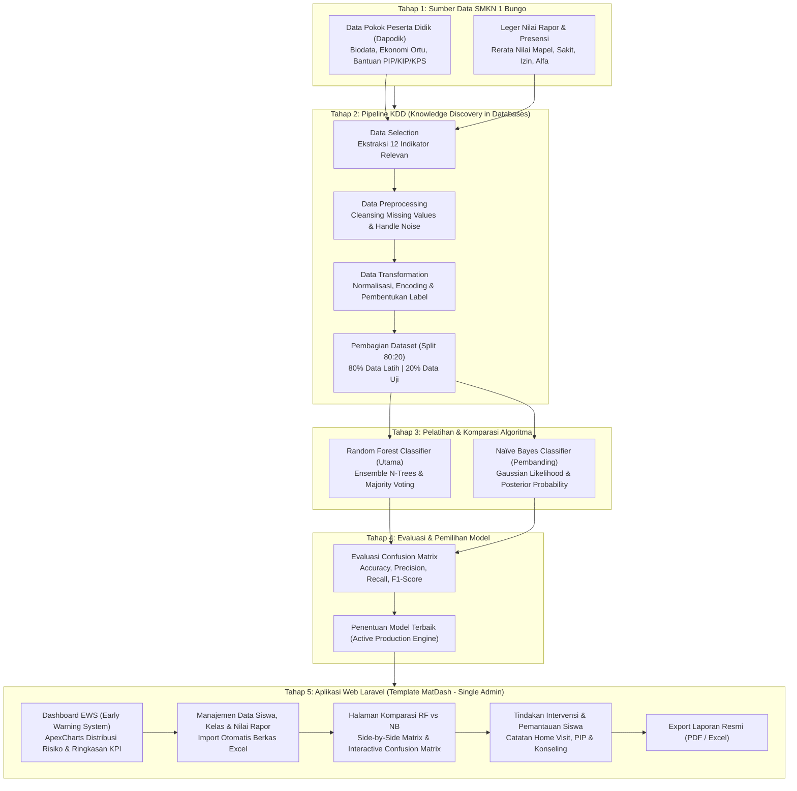
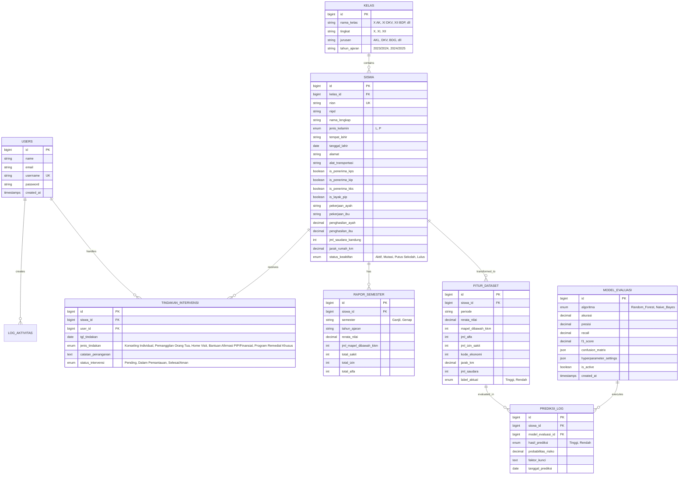

# Rancangan Sistem Cerdas Deteksi Dini Risiko Siswa Putus Sekolah
## Berbasis Framework Laravel & MySQL (Komparasi Random Forest & Naïve Bayes)
**Studi Kasus:** SMK Negeri 1 Bungo  
**Referensi:** Tesis Magister Teknik Informatika & Dataset Akademik/Sosio-Ekonomi SMKN 1 Bungo

---

## 1. Pendahuluan & Latar Belakang Sistem

Berdasarkan dokumen laporan penelitian (*Tesis S2 MTI*) dan dataset yang tersedia di SMK Negeri 1 Bungo, angka risiko putus sekolah dipengaruhi oleh integrasi beberapa indikator multidimensi:
1. **Faktor Akademik:** Rata-rata nilai rapor semester, tren penurunan nilai antar-semester, jumlah mata pelajaran di bawah standar ketuntasan/KKM.
2. **Faktor Kehadiran & Kedisiplinan:** Persentase ketidakhadiran tanpa keterangan (Alfa), Izin, dan Sakit.
3. **Faktor Sosial-Ekonomi & Demografi:** Kepemilikan bantuan sosial (KIP, KPS, KKS, usulan PIP), tingkat penghasilan orang tua/wali, status pekerjaan ayah/ibu, jumlah saudara kandung, serta jarak tempat tinggal ke sekolah.

Sistem cerdas ini dirancang sebagai aplikasi web berbasis **Laravel** (PHP 8.2+) dengan basis data relasional **MySQL** yang mampu melakukan:
- Manajemen data induk kesiswaan (Dapodik & Leger Nilai Rapor).
- Otomasi data preprocessing & transformation (imputation, encoding, aggregasi fitur).
- Klasifikasi ganda menggunakan **Random Forest** (Metode Utama) dan **Naïve Bayes** (Metode Komparasi).
- Analisis perbandingan model (*Accuracy, Precision, Recall, F1-Score, Confusion Matrix*).
- Dashboard peringatan dini (*Early Warning System / EWS*) untuk **Administrator Tunggal (Admin)** dalam memonitor, mendeteksi risiko, dan mencatat intervensi siswa secara menyeluruh.

---

## 2. Alur Penelitian & Pipeline KDD (Sesuai Bab III Dokumen Tesis)

Berdasarkan Subbab 3.1 Kerangka Penelitian dalam laporan tesis (*halaman 60-69*), tahapan penelitian dan alur pemrosesan data mining terdiri atas 11 tahapan terstruktur yang diadopsi ke dalam arsitektur sistem:

1. **3.1.1 Identifikasi Masalah:** Deteksi dini risiko putus sekolah yang selama ini manual, lambat, dan subjektif.
2. **3.1.2 Studi Literatur:** Landasan teori data mining, KDD, Random Forest, Naïve Bayes, dan faktor risiko putus sekolah.
3. **3.1.3 Pengumpulan Data:** Data Dapodik (Daftar PD) dan Leger Nilai Rapor/Presensi SMK Negeri 1 Bungo.
4. **3.1.4 Proses Knowledge Discovery in Database (KDD):**
   - *Data Selection:* Memilih atribut akademik, presensi, dan sosial ekonomi.
   - *Data Preprocessing:* Data cleaning (missing values, duplikasi, inkonsistensi).
   - *Data Transformation:* Encoding kategorikal, normalisasi, dan pembentukan label target.
   - *Data Mining:* Pembangunan model klasifikasi dengan Random Forest & Naïve Bayes.
   - *Evaluation:* Confusion matrix (Accuracy, Precision, Recall, F1-Score).
5. **3.1.5 Pembagian Data:** Rasio 80% Data Latih (Training Data) dan 20% Data Uji (Testing Data).
6. **3.1.6 Proses Algoritma Random Forest:** Pembentukan ensemble sejumlah pohon keputusan (*decision trees*) menggunakan bootstrap sampling dan feature bagging, serta prediksi akhir melalui majority voting.
7. **3.1.7 Proses Algoritma Naïve Bayes:** Perhitungan probabilitas awal (*prior*) dan kecenderungan atribut (*likelihood*) berdasar Teorema Bayes (Gaussian Naïve Bayes).
8. **3.1.8 Analisis dan Perbandingan Model:** Evaluasi komparatif metrik performa kedua algoritma.
9. **3.1.9 Penentuan Model Terbaik:** Pemilihan model dengan akurasi dan F1-Score terbaik sebagai mesin inferensi aktif.
10. **3.1.10 Implementasi Sistem:** Penerapan model ke dalam aplikasi web Laravel untuk Admin.
11. **3.1.11 Kesimpulan dan Saran:** Penyusunan laporan otomatis dan rekomendasi intervensi.

### Diagram Alur Lengkap Sistem (Mermaid Flowchart)



---

## 3. Fitur / Variabel Prediksi yang Digunakan

Berdasarkan struktur data `Daftar PD` dan `Leger Nilai Rapor` SMKN 1 Bungo, berikut atribut fitur yang diekstraksi ke dalam model:

| No | Nama Fitur | Kategori | Tipe Data | Sumber Data | Keterangan / Normalisasi |
|---|---|---|---|---|---|
| 1 | `rata_nilai_rapor` | Akademik | Float | Leger Rapor | Skala 0 - 100 |
| 2 | `mapel_dibawah_kkm` | Akademik | Integer | Leger Rapor | Jumlah mapel < batas tuntas (misal < 75) |
| 3 | `jml_alfa` | Presensi | Integer | Leger Rapor (Kolom A) | Total hari tanpa keterangan |
| 4 | `jml_izin` | Presensi | Integer | Leger Rapor (Kolom I) | Total izin |
| 5 | `jml_sakit` | Presensi | Integer | Leger Rapor (Kolom S) | Total sakit |
| 6 | `is_penerima_kip` | Sosial-Ekonomi | Boolean | Dapodik | 1 = Ya, 0 = Tidak |
| 7 | `is_penerima_kps` | Sosial-Ekonomi | Boolean | Dapodik | 1 = Ya, 0 = Tidak |
| 8 | `is_layak_pip` | Sosial-Ekonomi | Boolean | Dapodik | 1 = Ya, 0 = Tidak |
| 9 | `penghasilan_ortu_group` | Sosial-Ekonomi | Categorical/Int | Dapodik | 1: < 1 Juta, 2: 1-2 Juta, 3: 2-5 Juta, 4: > 5 Juta |
| 10 | `jarak_rumah_km` | Demografi | Float | Dapodik | Jarak rumah ke sekolah dlm KM |
| 11 | `alat_transportasi` | Demografi | Categorical/Int | Dapodik | 1: Jalan kaki, 2: Angkot, 3: Sepeda motor, dll. |
| 12 | `jml_saudara_kandung`| Sosio-Demografi | Integer | Dapodik | Jumlah tanggungan anak dalam KK |
| **Target** | `status_risiko` | Label Target | Enum | Status / Histori | `Tinggi` (Berisiko Putus Sekolah) / `Rendah` (Aman) |

---

## 4. Perancangan Skema Database (MySQL)

Berikut rancangan relasi basis data menggunakan konvensi Laravel Eloquent:



---

## 5. Struktur Modul Aplikasi Laravel

```text
app/
├── Http/
│   ├── Controllers/
│   │   ├── AuthController.php
│   │   ├── DashboardController.php
│   │   ├── SiswaController.php
│   │   ├── NilaiPresensiController.php
│   │   ├── MiningController.php           # Pipeline KDD & Train Model
│   │   ├── PredictionController.php       # Single & Batch Prediction
│   │   ├── KomparasiController.php        # Matrix Evaluasi RF vs NB
│   │   ├── IntervensiController.php       # Modul Tindak Lanjut Siswa oleh Admin
│   │   └── LaporanExportController.php
├── Models/
│   ├── User.php
│   ├── Kelas.php
│   ├── Siswa.php
│   ├── RaporSemester.php
│   ├── FiturDataset.php
│   ├── ModelEvaluasi.php
│   ├── PrediksiLog.php
│   └── TindakanIntervensi.php
└── Services/
    └── MachineLearning/
        ├── PreprocessingService.php       # Cleaning, Imputation, MinMax Scaling
        ├── RandomForestService.php        # Decision Trees Ensemble & Gini Impurity
        ├── NaiveBayesService.php          # Gaussian Naïve Bayes Calculator
        └── EvaluationMetricsService.php   # Matrix (TP, FP, TN, FN) & ROC
```

---

## 6. Logika Komparasi Dua Algoritma

1. **Random Forest (Metode Utama):**
   - Membangun ensemble dari $B$ Decision Trees (misal $n=100$ trees) dengan *bootstrap aggregating (bagging)*.
   - Menggunakan pemilihan fitur acak (*Feature Bagging*) pada tiap percabangan dengan kriteria **Gini Impurity**:
     $$Gini = 1 - \sum_{i=1}^K P_i^2$$
   - Prediksi akhir menggunakan **Majority Voting**:
     $$\hat{y} = \text{mode}\{f_1(x), f_2(x), \dots, f_B(x)\}$$
2. **Naïve Bayes (Metode Komparasi):**
   - Menghitung **Prior Probability** $P(C_k)$ dan **Likelihood** fitur menggunakan distribusi Gaussian atau Multinomial:
     $$P(X|C_k) = \prod_{i=1}^d P(x_i|C_k)$$
   - Mengambil keputusan kelas dengan nilai posterior tertinggi (*Maximum A Posteriori*):
     $$\hat{y} = \arg\max_{k} P(C_k) \prod_{i=1}^d P(x_i|C_k)$$
3. **Penyajian Komparasi Pada Web:**
   - Tabel perbandingan berdampingan (*Side-by-side table*): Akurasi, Presisi, Recall, F1-Score, Waktu Komputasi (ms).
   - Visualisasi Confusion Matrix 2x2 interaktif menggunakan Chart.js.
   - Pilihan kepada admin untuk memilih model mana yang dijadikan model aktif (*Production Inference Engine*).

---

## 7. Rancangan Database Seeder Laravel

File seeder disiapkan untuk mengisi data master pengguna, kelas SMKN 1 Bungo, data siswa sampel, nilai rapor semester, hasil evaluasi algoritma, serta log prediksi.

### File: `database/seeders/DatabaseSeeder.php`
```php
<?php

namespace Database\Seeders;

use Illuminate\Database\Seeder;

class DatabaseSeeder extends Seeder
{
    public function run(): void
    {
        $this->call([
            UserSeeder::class,
            KelasSeeder::class,
            SiswaSeeder::class,
            RaporSemesterSeeder::class,
            ModelEvaluasiSeeder::class,
            PrediksiSeeder::class,
        ]);
    }
}
```

### File: `database/seeders/UserSeeder.php`
```php
<?php

namespace Database\Seeders;

use Illuminate\Database\Seeder;
use App\Models\User;
use Illuminate\Support\Facades\Hash;

class UserSeeder extends Seeder
{
    public function run(): void
    {
        // Sistem hanya menggunakan satu aktor: Administrator Tunggal
        User::updateOrCreate(
            ['email' => 'admin@smkn1bungo.sch.id'],
            [
                'name' => 'Administrator Sistem Cerdas',
                'username' => 'admin',
                'email' => 'admin@smkn1bungo.sch.id',
                'password' => Hash::make('admin123'),
            ]
        );
    }
}
```

### File: `database/seeders/KelasSeeder.php`
```php
<?php

namespace Database\Seeders;

use Illuminate\Database\Seeder;
use App\Models\Kelas;

class KelasSeeder extends Seeder
{
    public function run(): void
    {
        $rombel = [
            ['nama_kelas' => 'X AK', 'tingkat' => 'X', 'jurusan' => 'Akuntansi dan Keuangan Lembaga', 'tahun_ajaran' => '2023/2024'],
            ['nama_kelas' => 'X BDG-1', 'tingkat' => 'X', 'jurusan' => 'Bisnis Digital', 'tahun_ajaran' => '2023/2024'],
            ['nama_kelas' => 'X DKV-1', 'tingkat' => 'X', 'jurusan' => 'Desain Komunikasi Visual', 'tahun_ajaran' => '2023/2024'],
            ['nama_kelas' => 'XI AKL', 'tingkat' => 'XI', 'jurusan' => 'Akuntansi dan Keuangan Lembaga', 'tahun_ajaran' => '2023/2024'],
            ['nama_kelas' => 'XI DKV-1', 'tingkat' => 'XI', 'jurusan' => 'Desain Komunikasi Visual', 'tahun_ajaran' => '2023/2024'],
            ['nama_kelas' => 'XII AKL', 'tingkat' => 'XII', 'jurusan' => 'Akuntansi dan Keuangan Lembaga', 'tahun_ajaran' => '2023/2024'],
            ['nama_kelas' => 'XII BDP-1', 'tingkat' => 'XII', 'jurusan' => 'Bisnis Daring dan Pemasaran', 'tahun_ajaran' => '2023/2024'],
            ['nama_kelas' => 'XII MM-1', 'tingkat' => 'XII', 'jurusan' => 'Multimedia', 'tahun_ajaran' => '2023/2024'],
        ];

        foreach ($rombel as $r) {
            Kelas::firstOrCreate(['nama_kelas' => $r['nama_kelas'], 'tahun_ajaran' => $r['tahun_ajaran']], $r);
        }
    }
}
```

### File: `database/seeders/SiswaSeeder.php`
```php
<?php

namespace Database\Seeders;

use Illuminate\Database\Seeder;
use App\Models\Siswa;
use App\Models\Kelas;

class SiswaSeeder extends Seeder
{
    public function run(): void
    {
        $kelasXAk = Kelas::where('nama_kelas', 'X AK')->first();
        $kelasId = $kelasXAk ? $kelasXAk->id : 1;

        $siswaSamples = [
            [
                'kelas_id' => $kelasId,
                'nisn' => '0091577109',
                'nipd' => '23241001',
                'nama_lengkap' => 'Ahmad Nabil',
                'jenis_kelamin' => 'L',
                'tempat_lahir' => 'Muara Bungo',
                'tanggal_lahir' => '2008-05-12',
                'alamat' => 'Jl. Lintas Sumatera Km 3, Bathin III',
                'alat_transportasi' => 'Sepeda Motor',
                'is_penerima_kps' => false,
                'is_penerima_kip' => false,
                'is_penerima_kks' => false,
                'is_layak_pip' => false,
                'pekerjaan_ayah' => 'Wiraswasta',
                'pekerjaan_ibu' => 'Ibu Rumah Tangga',
                'penghasilan_ayah' => 2500000,
                'penghasilan_ibu' => 0,
                'jml_saudara_kandung' => 2,
                'jarak_rumah_km' => 3.5,
                'status_keaktifan' => 'Aktif',
            ],
            [
                'kelas_id' => $kelasId,
                'nisn' => '0086426000',
                'nipd' => '23241002',
                'nama_lengkap' => 'Allini Toher Umi Jaya',
                'jenis_kelamin' => 'P',
                'tempat_lahir' => 'Bungo',
                'tanggal_lahir' => '2007-11-20',
                'alamat' => 'Dusun Sungai Mengkuang',
                'alat_transportasi' => 'Angkutan Umum',
                'is_penerima_kps' => true,
                'is_penerima_kip' => true,
                'is_penerima_kks' => true,
                'is_layak_pip' => true,
                'pekerjaan_ayah' => 'Buruh Harian Lepas',
                'pekerjaan_ibu' => 'Petani',
                'penghasilan_ayah' => 900000,
                'penghasilan_ibu' => 400000,
                'jml_saudara_kandung' => 5,
                'jarak_rumah_km' => 14.2,
                'status_keaktifan' => 'Aktif',
            ],
            [
                'kelas_id' => $kelasId,
                'nisn' => '0073350811',
                'nipd' => '23241003',
                'nama_lengkap' => 'Cristin Ayu Lita Br Manullang',
                'jenis_kelamin' => 'P',
                'tempat_lahir' => 'Bungo',
                'tanggal_lahir' => '2007-08-14',
                'alamat' => 'Kec. Rimbo Tengah',
                'alat_transportasi' => 'Sepeda Motor',
                'is_penerima_kps' => false,
                'is_penerima_kip' => false,
                'is_penerima_kks' => false,
                'is_layak_pip' => false,
                'pekerjaan_ayah' => 'PNS / Guru',
                'pekerjaan_ibu' => 'Pedagang',
                'penghasilan_ayah' => 4500000,
                'penghasilan_ibu' => 2000000,
                'jml_saudara_kandung' => 1,
                'jarak_rumah_km' => 4.0,
                'status_keaktifan' => 'Aktif',
            ],
            [
                'kelas_id' => $kelasId,
                'nisn' => '0071407417',
                'nipd' => '23241004',
                'nama_lengkap' => 'Devi Sri Rahayu',
                'jenis_kelamin' => 'P',
                'tempat_lahir' => 'Pelepat',
                'tanggal_lahir' => '2007-02-18',
                'alamat' => 'Dusun Rantau Keloyang',
                'alat_transportasi' => 'Jalan Kaki / Numpang',
                'is_penerima_kps' => true,
                'is_penerima_kip' => true,
                'is_penerima_kks' => false,
                'is_layak_pip' => true,
                'pekerjaan_ayah' => 'Tidak Bekerja / Sakit',
                'pekerjaan_ibu' => 'Buruh Cuci',
                'penghasilan_ayah' => 0,
                'penghasilan_ibu' => 650000,
                'jml_saudara_kandung' => 4,
                'jarak_rumah_km' => 18.0,
                'status_keaktifan' => 'Aktif',
            ]
        ];

        foreach ($siswaSamples as $s) {
            Siswa::firstOrCreate(['nisn' => $s['nisn']], $s);
        }
    }
}
```

### File: `database/seeders/RaporSemesterSeeder.php`
```php
<?php

namespace Database\Seeders;

use Illuminate\Database\Seeder;
use App\Models\Siswa;
use App\Models\RaporSemester;
use App\Models\FiturDataset;

class RaporSemesterSeeder extends Seeder
{
    public function run(): void
    {
        $siswas = Siswa::all();

        foreach ($siswas as $s) {
            if ($s->penghasilan_ayah + $s->penghasilan_ibu < 1500000 && $s->jarak_rumah_km > 10) {
                // Pola siswa berisiko tinggi
                $rerata = 71.4;
                $dibawahKkm = 4;
                $alfa = 14;
                $izin = 6;
                $sakit = 3;
                $label = 'Tinggi';
            } else {
                // Pola siswa berisiko rendah (kondusif)
                $rerata = 83.2;
                $dibawahKkm = 0;
                $alfa = 1;
                $izin = 2;
                $sakit = 1;
                $label = 'Rendah';
            }

            RaporSemester::firstOrCreate([
                'siswa_id' => $s->id,
                'semester' => 'Ganjil',
                'tahun_ajaran' => '2023/2024'
            ], [
                'rerata_nilai' => $rerata,
                'jml_mapel_dibawah_kkm' => $dibawahKkm,
                'total_sakit' => $sakit,
                'total_izin' => $izin,
                'total_alfa' => $alfa,
            ]);

            // Ekstraksi langsung ke data mining features
            FiturDataset::firstOrCreate([
                'siswa_id' => $s->id,
                'periode' => '2023/2024-Ganjil',
            ], [
                'rerata_nilai' => $rerata,
                'mapel_dibawah_kkm' => $dibawahKkm,
                'jml_alfa' => $alfa,
                'jml_izin_sakit' => $izin + $sakit,
                'kode_ekonomi' => ($s->is_layak_pip || $s->is_penerima_kip) ? 1 : 3,
                'jarak_km' => $s->jarak_rumah_km,
                'jml_saudara' => $s->jml_saudara_kandung,
                'label_aktual' => $label,
            ]);
        }
    }
}
```

### File: `database/seeders/ModelEvaluasiSeeder.php`
```php
<?php

namespace Database\Seeders;

use Illuminate\Database\Seeder;
use App\Models\ModelEvaluasi;

class ModelEvaluasiSeeder extends Seeder
{
    public function run(): void
    {
        // Model 1: Random Forest (Metode Utama)
        ModelEvaluasi::create([
            'algoritma' => 'Random_Forest',
            'akurasi' => 92.50,
            'presisi' => 91.20,
            'recall' => 93.80,
            'f1_score' => 92.48,
            'confusion_matrix' => json_encode([
                'tp' => 75,
                'fp' => 7,
                'tn' => 110,
                'fn' => 8
            ]),
            'hyperparameter_settings' => json_encode([
                'n_estimators' => 100,
                'max_depth' => 10,
                'criterion' => 'gini',
                'split_ratio' => '80:20'
            ]),
            'is_active' => true, // Model acuan sistem
        ]);

        // Model 2: Naïve Bayes (Metode Komparasi)
        ModelEvaluasi::create([
            'algoritma' => 'Naive_Bayes',
            'akurasi' => 84.00,
            'presisi' => 80.50,
            'recall' => 86.10,
            'f1_score' => 83.21,
            'confusion_matrix' => json_encode([
                'tp' => 68,
                'fp' => 16,
                'tn' => 100,
                'fn' => 16
            ]),
            'hyperparameter_settings' => json_encode([
                'type' => 'GaussianNB',
                'var_smoothing' => 1e-9,
                'split_ratio' => '80:20'
            ]),
            'is_active' => false,
        ]);
    }
}
```

### File: `database/seeders/PrediksiSeeder.php`
```php
<?php

namespace Database\Seeders;

use Illuminate\Database\Seeder;
use App\Models\Siswa;
use App\Models\ModelEvaluasi;
use App\Models\PrediksiLog;

class PrediksiSeeder extends Seeder
{
    public function run(): void
    {
        $rfModel = ModelEvaluasi::where('algoritma', 'Random_Forest')->first();
        if (!$rfModel) return;

        $siswas = Siswa::all();
        foreach ($siswas as $s) {
            $isHighRisk = ($s->is_layak_pip && $s->jarak_rumah_km > 10);
            
            PrediksiLog::firstOrCreate([
                'siswa_id' => $s->id,
                'model_evaluasi_id' => $rfModel->id,
            ], [
                'hasil_prediksi' => $isHighRisk ? 'Tinggi' : 'Rendah',
                'probabilitas_risiko' => $isHighRisk ? 0.88 : 0.12,
                'faktor_kunci' => $isHighRisk 
                    ? 'Jumlah alfa tinggi (14 hari), rerata nilai di bawah 75, status keluarga penerima KIP/PIP, jarak rumah > 10 km' 
                    : 'Presensi tertib, rerata nilai di atas KKM, dukungan sarana memadai',
                'tanggal_prediksi' => now()->toDateString(),
            ]);
        }
    }
}
```

---

## 8. Integrasi Template UI/UX (MatDash Bootstrap Free)

Aplikasi web Laravel ini dirancang menggunakan tema antarmuka **MatDash Bootstrap 5 Admin Template** (`matdash-bootstrap-free-main`), yang memberikan tampilan modern, bersih, responsif, dan kaya komponen statistik/analitik.

### 8.1 Pemetaan Aset Template ke Laravel
Aset template dari direktori `matdash-bootstrap-free-main/src/assets` dipetakan ke direktori Laravel `public/assets/`:
- `public/assets/css/styles.min.css`: Core framework styling.
- `public/assets/libs/bootstrap/dist/js/bootstrap.bundle.min.js`: Bootstrap 5 komponen.
- `public/assets/libs/apexcharts/dist/apexcharts.min.js`: Grafik performa model, distribusi risiko per jurusan, dan tren nilai siswa.
- `public/assets/libs/simplebar/dist/simplebar.js`: Sidebar navigation scroll styling.
- `public/assets/images/logos/`: Logo SMKN 1 Bungo & Favicon aplikasi.

### 8.2 Struktur Blade Layouts
```text
resources/views/
├── layouts/
│   ├── app.blade.php              # Master layout (Sidebar, Header, Main Content, Footer)
│   ├── auth.blade.php             # Authentication layout (Login page MatDash)
│   ├── partials/
│   │   ├── sidebar.blade.php      # Navigasi menu Admin
│   │   ├── header.blade.php       # Profil Admin, search, notifikasi EWS
│   │   └── footer.blade.php       # Hak cipta & versi sistem cerdas
├── auth/
│   └── login.blade.php            # Adopsi dari authentication-login.html
├── dashboard/
│   └── index.blade.php            # Adopsi dari index.html (KPI Card, Donut Chart, ApexCharts)
├── siswa/
│   ├── index.blade.php            # Master Data Siswa & Import Excel Dapodik
│   └── show.blade.php             # Profil detail siswa & histori nilai
├── nilai/
│   └── index.blade.php            # Leger Nilai & Presensi (S/I/A)
├── mining/
│   └── index.blade.php            # Setup KDD, Ekstraksi Fitur & Training Engine
├── komparasi/
│   └── index.blade.php            # Komparasi Akurasi RF vs NB & Interactive Confusion Matrix
├── intervensi/
│   └── index.blade.php            # Form Tindak Lanjut Admin (Home Visit, PIP, Konseling)
└── laporan/
    └── index.blade.php            # Export Rekapitulasi PDF / Excel
```

### 8.3 Navigasi Sidebar (Admin Menu Flow)
1. **DASHBOARD:**
   - *Overview EWS* (Ringkasan statistik risiko & model aktif)
2. **DATA MASTER & AKADEMIK:**
   - *Data Kelas & Rombel*
   - *Data Siswa (Dapodik)*
   - *Leger Nilai & Presensi*
3. **SISTEM CERDAS & MINING:**
   - *Pipeline KDD & Data Training*
   - *Deteksi Dini Siswa (Batch / Manual)*
   - *Komparasi Model (Random Forest vs Naïve Bayes)*
4. **TINDAK LANJUT & LAPORAN:**
   - *Intervensi & Pemantauan Siswa*
   - *Laporan & Cetak Rekapitulasi*

---

## 9. Penutup

Rancangan dokumen ini telah memetakan kebutuhan sistem berdasarkan dokumen tesis magister, kerangka KDD, data riil Dapodik dan Rapor SMKN 1 Bungo, skema tabel MySQL, serta kode seeder Laravel yang lengkap. Dokumen ini menjadi acuan utama sebelum fase coding dimulai.
